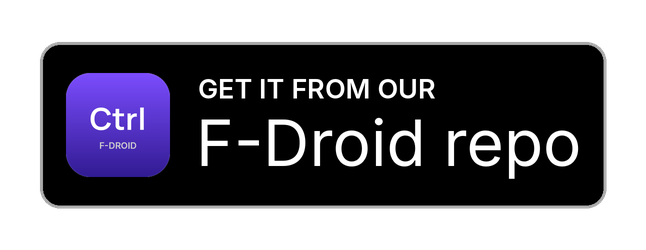

# LumenCtrl

**A private, offline photo and video editor, with on-device AI masks, AI Denoise and HDR.**

[](https://github.com/VoidedKN0X/LumenCtrl/releases/latest)  [](LICENSE)   [](https://github.com/sponsors/VoidedKN0X)

LumenCtrl edits photos and videos the way desktop raw editors do: every change is non-destructive, the original is never touched, and the whole look is rendered live on the phone's GPU. AI masks, AI Denoise and HDR all run on the phone itself. It has no internet permission, no account and no cloud, and never goes online.

Part of the [Ctrl series](#the-ctrl-series) by VKNXWorks.

<a href="https://apps.obtainium.imranr.dev/redirect?r=obtainium://add/https://github.com/VoidedKN0X/LumenCtrl"></a> <a href="https://voidedkn0x.github.io/CtrlF-Droid/"></a>

## Features

- **Works fully offline.** LumenCtrl doesn't have the internet permission and never goes online. No account, no sign-in, no cloud
- **Non-destructive:** the original stays untouched in LumenCtrl's private storage, and your edit is a small settings file beside it. Undo and redo, a named history, saved versions, hold to compare with the original, and reset at any time
- **Edit tools:**
  - **Light:** exposure, contrast, highlights, shadows, whites and blacks, on-device Auto, and a live histogram
  - **Curve:** parametric curve plus RGB, red, green and blue point curves
  - **Color:** temperature, tint, vibrance and saturation, with a white-balance eyedropper
  - **Mixer:** hue, saturation and luminance for 8 color bands
  - **Grading:** shadows, midtones, highlights and global, with blending and balance
  - **Effects:** texture, clarity, dehaze, fade, vignette, grain and glow
  - **Detail:** AI Denoise, sharpening and noise reduction
  - **Optics:** distortion, lens vignetting, chromatic aberration, purple and green defringe
  - **Blur:** lens blur, radial or tilt-shift, tap to set the focus
- **Masks:** linear, radial, luminance range and color range, each with 10 local sliders
- **Offline AI masks:** select the Subject, Background, People, Face skin, Body skin, Hair, Clothes or Sky with one tap, worked out on the phone in about half a second
- **Offline AI Denoise:** Quality or Fast. It runs once per photo; an Amount slider then blends it in live
- **Heal and clone** spots, with the source picked for you
- **Object removal:** brush over something (a person in the background, a bin, a wire) and LumenCtrl fills it in from the rest of the photo, on the phone, without any AI model or download
- **Text and drawing:** add text layers (size, colour, optional background box, drag to place) and draw freehand on photos; they're part of the edit, so you can move, change or undo them at any time, and they're drawn into exports, thumbnails and slideshows exactly as in the editor
- **Crop:** aspect locks, rotate, flip, auto-straighten, and vertical and horizontal perspective
- **Presets:** 12 looks with an amount slider; **save your own** from any edit (sliders, curves and LUT); copy and paste an edit onto other photos
- **LUTs:** import 3D LUTs (`.cube` files, up to 96³) from colour-grading apps and LUT packs, and blend them in with an amount slider, on photos and videos
- **HDR:**
  - Edit in HDR with an HDR limit, highlight boost and separate SDR highlights
  - See it on HDR screens, and visualise which parts go brighter than SDR white
  - Export Ultra HDR JPEGs that also look right on SDR screens
  - Merge 2 to 7 bracketed shots into one HDR photo
- **Video:** the same looks on videos, plus trim, mute and speed (0.5×, 1× or 2×); crop with a draggable frame, rotate and flip; add **music** from your phone (mixed with the clip's own sound or on its own, with a volume slider and a fade-out); make a reel from several clips
- **Library:** search, filters, sort, star ratings, pick and reject flags, albums, slideshow and collage
- **Import** from the Photo Picker, the camera, share and "Open with" from any app, or **straight from a camera over USB** (PTP/MTP), with photos you already have left unselected
- **Edit in LumenCtrl** from any gallery app: its "Edit" button offers LumenCtrl for photos and videos. LumenCtrl copies the item into its library and opens it in the editor; the gallery's own file is never changed, and your edit is saved through Export as usual
- **Export:**
  - JPEG, PNG, WebP, HEIC or AVIF, quality and size. HEIC and AVIF use the phone's own HEVC and AV1 encoders (AVIF only shows on phones that have an AV1 encoder) and are saved without any metadata
  - Metadata policy: keep it without location (the default), keep all, or strip all
  - Optional watermark, and an optional edit record in the file
  - Save to the gallery or share; one photo or a batch
- **Library export and import:** your whole library (originals, edits, versions, ratings, flags, albums, AI masks, denoised copies, removals, music, your presets and LUTs) in one ZIP file, to move to a new phone or keep as a backup; importing adds only what's missing and never replaces or deletes anything
- **Settings export and import:** your privacy switches, accent and export defaults in a small file; importing shows every setting it would change first, and never touches the app lock
- **App lock** with fingerprint, face or your screen lock, and **Hide in screenshots** / **Hide in recent apps** (all off until you turn them on)
- **Ctrl / Signal look**, shared by every Ctrl app: dark and light, high contrast, four accent colors, Space Grotesk and JetBrains Mono

## Requirements

- Android 15 or newer, on a 64-bit ARM phone (nearly every phone from the last several years) with OpenGL ES 3.0
- HDR view needs an HDR screen; everything else, including Ultra HDR export, works on any screen
- USB import needs a phone with USB host (OTG) support and a camera that offers PTP or MTP
- Works on any Android ROM as a normal app: stock Android, LineageOS, GrapheneOS, CalyxOS, /e/OS and the phone makers' own systems. It doesn't need root or to be built into the system.
- **Google-free and de-Googled:** no Google Play services, Firebase or Google SDKs, and the app never contacts Google. The one Google-made part is [LiteRT](https://github.com/google-ai-edge/LiteRT), the open-source (Apache 2.0) engine that runs the AI models on the phone; it has no Play services, no Firebase, no network code path, and runs without any Google software on the phone. See [Is it safe to install?](#is-it-safe-to-install)

## Install

1. Open the [latest release](https://github.com/VoidedKN0X/LumenCtrl/releases/latest) on your phone, scroll down to **Assets** and tap the file that ends in `.apk` (for example `LumenCtrl-v0.1.0.apk`). The "Source code" zip and tar.gz files are not the app; you don't need them.
2. Open it on your phone. Android may ask you to allow installing apps from your browser or file manager.
3. Updates install over the old version. Your library and settings are kept.

**Automatic updates:** on your phone, tap one of the buttons above.

- **Obtainium:** install [Obtainium](https://github.com/ImranR98/Obtainium) first. The button adds LumenCtrl and installs every new release for you.
- **F-Droid:** adds the [CtrlF-Droid repo](https://voidedkn0x.github.io/CtrlF-Droid/) to F-Droid, Droid-ify or Neo Store, with every Ctrl app and automatic updates.

If the Obtainium button doesn't open the app, add `https://github.com/VoidedKN0X/LumenCtrl` in Obtainium by hand.

## Getting started

- **Import:** tap **Import** and pick photos or videos, tap the camera to take one, or share a photo to LumenCtrl from any app. To import from a camera, connect it over USB and tap the USB icon (or accept LumenCtrl's offer when you plug it in).
- **From your gallery:** in your gallery app, tap **Edit** (or "Edit with") on a photo or video and pick LumenCtrl. It opens straight in the editor; with the app lock on, after you unlock.
- **Edit:** tap a photo. The bar at the bottom has **Presets**, **Edit** (all the tool groups), **Masks**, **Heal**, **Text & draw** and **Crop**. Pinch or double-tap to zoom; hold the compare button to see the original.
- **Your presets:** in **Presets**, tap **Save current look** to keep this photo's look as a preset; it appears under **Your presets** with its own amount slider.
- **LUTs:** in **Edit > Color**, tap **Import .cube** and pick a LUT file. It's stored in LumenCtrl and listed there for every photo and video.
- **Remove an object:** in **Heal**, switch to **Remove object**, paint over it (a little past its edges) and tap **Remove**.
- **Text and drawing:** in **Text & draw**, tap **Add text**, type, and drag it into place; tap a text to change its size or colour. Switch to **Draw** to draw with one finger.
- **AI masks:** in **Masks**, tap one of the AI chips (Subject, Sky, People and so on), then use the local sliders.
- **AI Denoise:** in **Edit > Detail**, tap **Quality** (best) or **Fast**, keep the editor open until it's done, then set **Amount**.
- **HDR:** in **Edit > Light**, turn on **HDR**. Export it with **Ultra HDR** on to keep the extra brightness.
- **Export:** tap the download button at the top right. In the library, long-press to select several photos and export, rate, flag, add to an album or paste an edit onto all of them; **Create** makes a collage, an HDR merge or a reel.
- **Settings** (gear in the library): privacy, accent color, storage, library backup and About.
- **Library backup:** **Settings > Library backup > Export** writes everything to one ZIP file wherever you choose (a folder, a USB stick, a file manager). On another phone, **Import** reads it, shows what it will add, and adds only what isn't there yet.

## Is it safe to install?

- **Open source.** All of LumenCtrl's code is in this repo, under the GPL-3.0 licence. Anyone can read it.
- **Built by GitHub, not on a personal computer.** Every release on the Releases page is built by [the build workflow](.github/workflows/build.yml) on GitHub Actions, straight from the code in this repo. Each build also checks that the app has no network permission and no Google libraries other than LiteRT. The signing key is kept away from the build: one job builds the APK without any secrets, and a separate job that runs no code from this repo signs it and checks the signature against the fingerprint below.
- **Always signed with the same key.** Android refuses to install an update signed with a different key over LumenCtrl, and the CtrlF-Droid repo only accepts APKs signed with this key. The SHA-256 fingerprint of LumenCtrl's signing certificate is:

  ```
  FD:ED:53:E2:14:DD:BA:D3:3B:B3:54:DD:81:37:99:15:5D:19:26:89:6E:F1:AB:28:8C:BD:2E:A3:3E:47:BE:81
  ```

  Advanced users can check it with [AppVerifier](https://github.com/soupslurpr/AppVerifier).

**Check a download.** Every release is built and published by GitHub Actions, never on a personal computer:

- The release notes end with the APK's **SHA-256** checksum. Compare it with `sha256sum LumenCtrl-vX.Y.Z.apk` (or `Get-FileHash` on Windows).
- Each release APK has a signed **build provenance attestation**. With the [GitHub CLI](https://cli.github.com/), `gh attestation verify LumenCtrl-vX.Y.Z.apk -R VoidedKN0X/LumenCtrl` proves it was built by this repo's workflow from the tagged commit.
- The signing-certificate fingerprint above stays the same for every release.

**Permissions.** LumenCtrl has **no internet permission**: it can't go online at all. It doesn't ask for storage, camera, location or photo-library access either: imports go through Android's Photo Picker or the app you share from, photos are taken by your camera app, and exports are saved through Android's media store.

| Permission | What LumenCtrl uses it for |
| --- | --- |
| Use biometric hardware, use fingerprint hardware | Optional fingerprint or face unlock for the app lock. |
| App-internal broadcasts (`com.vknxworks.lumenctrl.DYNAMIC_RECEIVER_NOT_EXPORTED_PERMISSION`) | Added by AndroidX so that only LumenCtrl itself can send to its own internal receivers. It isn't something you grant and gives no access to anything. |

USB camera import asks Android for access to that one camera when you connect it; Android shows the prompt.

See [Privacy](#privacy) for what happens to your data.

## App lock

Turn it on under **Settings > Privacy > App lock**. It's off until you turn it on.

- Unlocks with your fingerprint, face or the phone's screen lock, through Android's own BiometricPrompt. Only biometrics Android classes as strong (Class 3) are accepted; with a weaker one, such as camera-only face unlock, the prompt asks for the screen lock. LumenCtrl never sees or stores your PIN or biometrics.
- Your phone needs a screen lock first; Settings tells you when it doesn't have one.
- The app locks again when you've been away from it for more than a minute.
- Photos another app shares into LumenCtrl while it's locked are imported after you unlock.

**Hide in screenshots** and **Hide in recent apps** (both off by default): the first keeps LumenCtrl out of screenshots and screen recordings, the second shows a blank card in the recent-apps view while screenshots still work.

## Privacy

**Telemetry-free.** LumenCtrl has no analytics, crash reporting, usage stats or tracking of any kind. It has **no internet permission**, works fully offline and never connects to the internet. Every build checks that the app has no network permission.

- Your library (originals, edits, AI masks and denoised copies) is stored in LumenCtrl's private app storage, encrypted with the phone, and can't be read by other apps.
- **AI runs on the phone.** The AI models are bundled in the app and run on the phone's processor; no photo, mask or result ever leaves the phone.
- **Exports remove your location by default.** You can keep all metadata, keep it without location, or strip it all. The optional edit record holds only the edit settings.
- Sharing hands the receiving app read access to that one export only. Save to gallery puts a copy in Pictures/Lumen (videos in Movies/Lumen), where other apps with media access can see it.
- Android backups don't include LumenCtrl's library, and LumenCtrl is left out of Android's cloud backup and its phone-to-phone transfer.
- **Library export** writes a plain (not encrypted) ZIP file only where you choose, with your photos and their original metadata (including location) as you imported them. Keep it somewhere private.

## How it works

LumenCtrl follows the design of desktop raw editors, written from scratch for Android.

- **One shader for everything.** The whole develop pipeline (spots, masks, lens corrections, noise reduction, sharpening, tone, curves, color, grading, effects, HDR) is a single OpenGL ES 3.0 fragment shader. The preview, the histogram, exports, thumbnails and video frames all go through it, so what you see is what you export.
- **Edits are data.** Each slider is one entry in the `Param` list; the edit is saved as JSON beside the untouched original.
- **Object removal** (`edit/Inpaint.kt`, `edit/Removals.kt`): content-aware fill written from scratch, no model. The brushed area and a margin around it are worked on at up to 1024 px; a coarse-to-fine pyramid runs PatchMatch to find, for every 7×7 patch touching the hole, the most similar patch outside it, and each hole pixel becomes the weighted average of what those patches say. The result is stored beside the photo as a small PNG patch with soft edges and drawn over the source picture before everything else (preview, export, thumbnails, AI Denoise), so the original stays untouched and Undo simply takes the patch away. It works best on plain or repeating backgrounds; large objects in busy scenes can leave visible repeats.
- **LUTs** (`model/CubeLut.kt`, `data/Luts.kt`): a `.cube` file is parsed once on import and stored as a small binary table; the shader samples it as a 3D texture (half floats, trilinear) after colour grading, so preview, export and video all use the same table.
- **AI masks** (`edit/Segmenter.kt`): two bundled segmentation models find people, animals, vehicles and body parts. The winning class at each pixel becomes the mask, a guided filter snaps it to the photo's edges, and it's stored beside the photo. Sky uses LumenCtrl's own rules: smooth, bright or blue, connected to the top edge, and not warm-tinted.
- **AI Denoise** (`edit/Denoiser.kt`): the photo (up to 4096 px) is processed in 256 px tiles with 16 px overlaps. Each tile's average color is pinned to the original's, and the coarse tones are taken from the original, so the result has no tile seams or color casts. It's saved once as a denoised copy and blended live with Amount. On the test phone, a 4.3 MP photo takes about 20 s with Fast and 30 s with Quality.
- **HDR** (`render/Hdr.kt`, `edit/HdrMerge.kt`): the shader also renders a gain map, the extra brightness each pixel should get on an HDR screen. Exports pair it with the SDR image as an Ultra HDR JPEG. Photos that already have a gain map keep their HDR. Merge to HDR aligns the brackets, merges them weighted by exposure, tone-maps the result and stores a +3 stop gain map.
- **Video** (`render/VideoGl.kt`, `render/VideoExporter.kt`): Android's built-in decoder feeds frames to the same shader; the encoder writes H.264 MP4 at 30 fps up to 4K. The original audio is copied without re-encoding when the speed isn't changed. With music (`render/AudioMix.kt`), the music and the clip's own sound are decoded, mixed at 48 kHz stereo and encoded once to AAC, all with Android's own codecs.
- **USB import** (`data/CameraImport.kt`): Android's built-in PTP/MTP support, no extra libraries. DNG decodes fully; other raw formats depend on what the phone's decoder can read, usually the embedded preview.

### Bundled AI models

All models ship inside the APK; nothing is downloaded.

| Used for | File | Source | Licence |
| --- | --- | --- | --- |
| AI masks: Subject, Background, People | `deeplab_v3.tflite` (2.7 MB) | Google MediaPipe | Apache 2.0 |
| AI masks: Face skin, Body skin, Hair, Clothes | `selfie_multiclass.tflite` (16.4 MB) | Google MediaPipe | Apache 2.0 |
| AI Denoise, Quality | `nafnet_rgb_large.tflite` (4.7 MB) | [Raspberry Pi AI_denoise](https://github.com/raspberrypi/AI_denoise) | BSD-2-Clause ([licence](app/src/main/assets/models/AI_denoise_LICENSE.txt)) |
| AI Denoise, Fast | `unet_rgb_fast.tflite` (0.7 MB) | [Raspberry Pi AI_denoise](https://github.com/raspberrypi/AI_denoise) | BSD-2-Clause ([licence](app/src/main/assets/models/AI_denoise_LICENSE.txt)) |

```text
deeplab_v3.tflite         sha256 ff36e24d40547fe9e645e2f4e8745d1876d6e38b332d39a82f0bf0f5d1d561b3
selfie_multiclass.tflite  sha256 c6748b1253a99067ef71f7e26ca71096cd449baefa8f101900ea23016507e0e0
nafnet_rgb_large.tflite   sha256 5ddaec25b050051fb50a2a575fdbd093ab051984e714aafbcef5efd7ee388ca4
unet_rgb_fast.tflite      sha256 53f0112f248b18ae518af64942ea4741f5b22ccdc4af5aea0ff452875f17fb84
```

These are small mobile models. They work well on clear people, pet and vehicle photos and on typical high-ISO noise, and are weaker on cluttered scenes.

### Code map

| Path | What it holds |
| --- | --- |
| `model/` | `Param` list (also the shader's packing order), the edit sidecar, masks, spots, curves, presets |
| `render/Shaders.kt` | The whole develop pipeline in one fragment shader |
| `render/` | GL plumbing, live preview, off-screen export, Ultra HDR, video |
| `edit/` | Auto tools, AI masks, AI Denoise, HDR merge |
| `data/` | Library catalog, image loading, settings, USB camera import |
| `ui/ctrl/` | The Ctrl / Signal design system |
| `ui/editor/`, `ui/` | Editor, panels and sheets; library, export, slideshow, collage, settings |

To add a slider, add an entry to `Param` and use `P_<key>` in the shader; the UI, saving, presets, undo and export pick it up.

## How LumenCtrl is made

LumenCtrl is a one-person project by VoidedKN0X (VKNXWorks). Much of the code is written with the help of AI (Claude, by Anthropic). I decide what the app does, review the changes and use the app myself. Every change is listed in the [changelog](CHANGELOG.md), and you can read every line of code here.

## Build from source

You need [Android Studio](https://developer.android.com/studio), or JDK 17 and the Android SDK.

1. Clone the repo:
   ```bash
   git clone https://github.com/VoidedKN0X/LumenCtrl.git
   cd LumenCtrl
   ```
2. Build the app:
   ```bash
   ./gradlew assembleDebug
   ```
   On Windows, use `gradlew.bat assembleDebug`.
3. The APK is in `app/build/outputs/apk/debug/`. Copy it to your phone and install it. Debug builds install next to the release as "com.vknxworks.lumenctrl.debug".

Or open the folder in Android Studio and press **Run** with your phone connected.

## Support the project

LumenCtrl is free and open source. If it's useful to you, you can support development on [GitHub Sponsors](https://github.com/sponsors/VoidedKN0X). Please report bugs and ideas with the [bug report and feature request forms](https://github.com/VoidedKN0X/LumenCtrl/issues/new/choose). Starring the repo helps too.

Found a security problem? Please don't open a public issue; see [SECURITY.md](SECURITY.md).

## The Ctrl series

Native Android apps for self-hosted services and everyday tools, all with the same design.

| App | What it's for |
| --- | --- |
| [AdCtrl](https://github.com/VoidedKN0X/AdCtrl) | Control your AdGuard Home DNS server |
| [ArrCtrl](https://github.com/VoidedKN0X/ArrCtrl) | Radarr, Sonarr, Prowlarr, Bazarr, qBittorrent, autobrr and Cleanuparr in one app |
| [BeamCtrl](https://github.com/VoidedKN0X/BeamCtrl) | TV remote for phones with an IR blaster |
| [CallCtrl](https://github.com/VoidedKN0X/CallCtrl) | Phone app: dialer, call history and in-call screen |
| [CameraCtrl](https://github.com/VoidedKN0X/CameraCtrl) | Private camera with RAW (DNG) on every lens |
| [ChatCtrl](https://github.com/VoidedKN0X/ChatCtrl) | Matrix chat client for matrix.org and self-hosted Synapse |
| [ClockCtrl](https://github.com/VoidedKN0X/ClockCtrl) | Alarms, timers, stopwatch and world clock |
| [ContactCtrl](https://github.com/VoidedKN0X/ContactCtrl) | Contacts: browse, edit, import and export |
| [CraftyCtrl](https://github.com/VoidedKN0X/CraftyCtrl) | Manage Minecraft servers on Crafty Controller |
| [DateCtrl](https://github.com/VoidedKN0X/DateCtrl) | Calendar for the calendars on your phone and your accounts |
| [FilesCtrl](https://github.com/VoidedKN0X/FilesCtrl) | File manager with NFS, SMB, SFTP, FTP and WebDAV |
| [FrigateCtrl](https://github.com/VoidedKN0X/FrigateCtrl) | Watch and review your Frigate NVR cameras |
| [GalleryCtrl](https://github.com/VoidedKN0X/GalleryCtrl) | Private, offline gallery with an encrypted vault |
| [ImmichCtrl](https://github.com/VoidedKN0X/ImmichCtrl) | Photos and backup for your Immich server |
| [JellyCtrl](https://github.com/VoidedKN0X/JellyCtrl) | Movies, shows, music and Live TV from Jellyfin |
| [LijnCtrl](https://github.com/VoidedKN0X/LijnCtrl) | Live De Lijn bus and tram departures |
| **LumenCtrl** (this app) | Private, offline photo and video editor |
| [MailCtrl](https://github.com/VoidedKN0X/MailCtrl) | Email for Gmail and Proton Mail |
| [MapsCtrl](https://github.com/VoidedKN0X/MapsCtrl) | Private, offline maps and navigation |
| [MemoCtrl](https://github.com/VoidedKN0X/MemoCtrl) | Notes on your Memos server |
| [NaviCtrl](https://github.com/VoidedKN0X/NaviCtrl) | Music player for Navidrome servers |
| [PaperCtrl](https://github.com/VoidedKN0X/PaperCtrl) | Scan and browse documents on Paperless-ngx |
| [PrintCtrl](https://github.com/VoidedKN0X/PrintCtrl) | Bambu Lab printers through Bambuddy, and Spoolman spools |
| [ProxCtrl](https://github.com/VoidedKN0X/ProxCtrl) | Manage your Proxmox VE server |
| [RecorderCtrl](https://github.com/VoidedKN0X/RecorderCtrl) | Private, offline voice recorder |
| [RideCtrl](https://github.com/VoidedKN0X/RideCtrl) | Offline maintenance, fuel and mod log for your vehicles |
| [SeerrCtrl](https://github.com/VoidedKN0X/SeerrCtrl) | Request movies and shows on Seerr / Jellyseerr |
| [ShutterCtrl](https://github.com/VoidedKN0X/ShutterCtrl) | Remote control and photo transfer for Canon cameras |
| [SoundCtrl](https://github.com/VoidedKN0X/SoundCtrl) | JBL headphones and speakers, without the account |
| [SumCtrl](https://github.com/VoidedKN0X/SumCtrl) | Offline calculator, unit converter and work tools |
| [SynapseCtrl](https://github.com/VoidedKN0X/SynapseCtrl) | Administer your Matrix Synapse server |
| [TalkCtrl](https://github.com/VoidedKN0X/TalkCtrl) | Cardo intercom settings, radio and updates |
| [TapoCtrl](https://github.com/VoidedKN0X/TapoCtrl) | Tapo plugs and bulbs on your home network |
| [TextCtrl](https://github.com/VoidedKN0X/TextCtrl) | Private SMS and MMS messaging |
| [TrueCtrl](https://github.com/VoidedKN0X/TrueCtrl) | Monitor and manage your TrueNAS server |
| [WakeCtrl](https://github.com/VoidedKN0X/WakeCtrl) | Keep the screen awake, per app or while charging |
| [WrtCtrl](https://github.com/VoidedKN0X/WrtCtrl) | Manage your OpenWrt router |

## License

LumenCtrl is licensed under the [GNU General Public License v3.0](LICENSE). © VKNXWorks

Fonts, bundled in the app (nothing is downloaded): [Space Grotesk](https://github.com/floriankarsten/space-grotesk) and [JetBrains Mono](https://github.com/JetBrains/JetBrainsMono), both under the SIL Open Font License 1.1 ([FONT-LICENSE-SpaceGrotesk.txt](FONT-LICENSE-SpaceGrotesk.txt), [FONT-LICENSE-JetBrainsMono.txt](FONT-LICENSE-JetBrainsMono.txt)).

AI models: see [Bundled AI models](#bundled-ai-models). On-device inference: [LiteRT](https://github.com/google-ai-edge/LiteRT), Apache 2.0.
